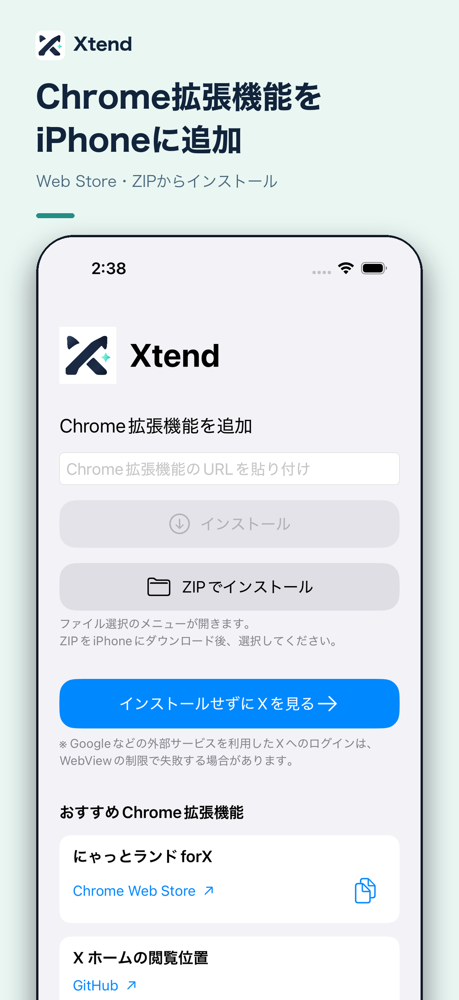
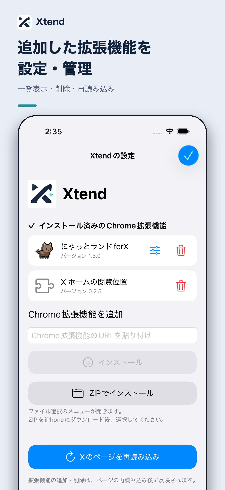

<div align="center">
  
  <h1>Xtend</h1>
  <p><strong>Chrome拡張機能をインストールできるX専用アプリ✨</strong></p>
</div>

<p align="center">
  <a href="./docs/images/app-store/02-add-extensions.png"></a>
  <a href="./docs/images/app-store/03-manage-extensions.png"></a>
</p>

## おすすめの拡張機能

### 🐈 [にゃっとランドforX](https://chromewebstore.google.com/detail/にゃっとランドforx/kchlmbffcbaambfigakeiamkhgacemng)

このChrome拡張機能をiPhoneで使うためにXtendを作りました。ぜひダウンロードして使ってみてください。

作者様：[@karou2rikon](https://x.com/karou2rikon)

### 📍 [x-home-anchor](https://github.com/akiweb8528/x-home-anchor)

Xホームの「新しいポストを表示」を押したあとも、閲覧位置を保持する拡張機能です。

GitHubリポジトリ内の`release/`にあるビルド済みZIPをダウンロードし、Xtendの設定から「ZIPでインストール」で追加してください。

## 注意事項

> [!WARNING]
> - Googleアカウント経由のXログインは、埋め込みWebViewに対するGoogleのOAuth制限で動作を保証できません。Xのユーザー名・メールアドレス・電話番号でのログインを利用してください。
> - Xの閲覧にはWKWebViewを使用しています。ただし通常のブラウザとして認識されない可能性があります（作者本人が常用していてBAN等はされていませんが、X側の判断に依るため保証できません）。ご利用には十分ご注意をお願いいたします。
> - Chrome拡張機能はPC上のChromeでの利用が通常であるところを、このアプリではiPhoneでの利用を可能にしています。Chrome拡張機能自体の安全性については本アプリの責務外であるとのご認識の上でご利用ください。

## iPhoneへのインストール

**必要なもの：** macOS、iOS 18以降に対応するXcode、Apple IDでサインイン済みのXcode、USBまたはペアリング済みのiPhone（開発者モード有効）、[Homebrew](https://brew.sh/)。

1. このリポジトリをMacにダウンロードし、ターミナルでそのフォルダに移動します。
2. **Team ID（10文字）**：Xcodeの **Settings → Accounts** にApple Accountを追加します。
   - Apple Developer Program加入者： [Apple Developerのアカウント](https://developer.apple.com/account/) → **メンバーシップの詳細** に表示されます。
   - 無料の **Personal Team**：下のコードの `brew install xcodegen` と `xcodegen generate` を先に実行し、`open Xtend.xcodeproj` → **Xtend → Signing & Capabilities → Team** でPersonal Teamを選択。その後 `xcodebuild -project Xtend.xcodeproj -scheme Xtend -showBuildSettings | grep DEVELOPMENT_TEAM` に表示されるIDを使います。
3. **端末ID**：iPhoneをMacに接続し「信頼」を選択します。`xcrun devicectl list devices` の一覧で、iPhoneの行の **Identifier** をコピーします（**physical** の端末を選び、**simulated** は選ばない）。
4. 下の `TEAM_ID="YOUR_TEAM_ID"` と `DEVICE_ID="YOUR_DEVICE_ID"` を取得した値に書き換え、コマンドを実行します。

```sh
brew install xcodegen
xcodegen generate
xcrun devicectl list devices

TEAM_ID="YOUR_TEAM_ID"
DEVICE_ID="YOUR_DEVICE_ID"
BUNDLE_ID="dev.$(whoami).xtend"

xcodebuild -project Xtend.xcodeproj -scheme Xtend \
  -configuration Debug \
  -destination "platform=iOS,id=$DEVICE_ID" \
  -derivedDataPath .build/DerivedData \
  -allowProvisioningUpdates \
  DEVELOPMENT_TEAM="$TEAM_ID" \
  PRODUCT_BUNDLE_IDENTIFIER="$BUNDLE_ID" \
  CODE_SIGN_STYLE=Automatic build

xcrun devicectl device install app --device "$DEVICE_ID" \
  .build/DerivedData/Build/Products/Debug-iphoneos/Xtend.app
xcrun devicectl device process launch --device "$DEVICE_ID" "$BUNDLE_ID"
```

アプリが起動したら、必要に応じて「にゃっとランドforX」を追加するか、インストールせずにXを開けます。

> [!NOTE]
> 署名のために自分のApple IDとTeamが必要です。Bundle IDが他と重複する場合は `BUNDLE_ID` を変更してください。無料のPersonal Teamでは署名・プロビジョニングに制限があります。コマンドで署名が通らない場合は `open Xtend.xcodeproj` でXcodeを開き、**Signing & Capabilities** を確認してください。

Simulatorでのビルド、Xcodeによる実機インストール、ZIPのビルド手順は [開発者向けドキュメント](docs/DEVELOPMENT.md) にまとめています。

## GitHub Releasesから拡張機能を追加

Xtendの初回画面または設定画面に、GitHubリポジトリのURL（例：`https://github.com/OWNER/EXTENSION-REPOSITORY`）を貼り付けると、**最新の公開済みReleaseに添付されたビルド済みZIP**を取得してインストールします。ソースコードの自動生成ZIPは使用しません。対象ZIPを一意に選べない場合はエラーを表示します。

PrivateリポジトリはGitHubの読み取り専用トークンが必要です。Fine-grained Personal Access Tokenを対象リポジトリに限定し、**Contents: Read-only**で発行して入力してください。成功後は端末内Keychainへ保存され、設定画面から削除できます。GitHubへの接続は利用者がインストールを押した場合のみ行い、拡張機能の自動更新は行いません。

※ x-home-anchorの配布ZIPはGitHub Releasesではなくリポジトリ内の`release/`にあるため、従来のZIPインストールを利用します。
設定画面のインストール済み一覧には「更新を確認」ボタンがあります。GitHubから導入済みなら取得元を再利用し、ZIPやWeb Storeから導入した拡張機能では一度だけGitHubのクローンURL（HTTPSの`.git`、`git@github.com:owner/repo.git`も可）を貼り付けます。新しいReleaseがあれば「最新版を取り込む」を押すことで、同じ拡張機能を検証して更新します。自動チェック・自動適用はしません。


## ZIPから拡張機能を更新

Xtendの設定では、インストール済みChrome拡張機能の一覧と削除、ページの再読み込み、Chrome Web StoreのURL・ZIPからのインストールができます。X向けManifest V3のコンテンツスクリプトを持つ拡張機能を、個別の名前登録なしで追加できます。Web Storeから取得したCRX3は署名と拡張機能IDを検証し、ZIPは配布元を自分で確認してください。設定画面を同梱している拡張機能は、一覧の設定アイコンから個別の設定画面を開けます。

ソースからのZIP作成手順は[開発者向けドキュメント](docs/DEVELOPMENT.md)を参照してください。

XtendはChromeそのものではありません。X上のJavaScript・CSSと、拡張機能ごとの基本的な保存領域などに対応します。`background.service_worker` やChrome固有の一部API、一般の設定画面などは実行できず、拡張機能の全機能が動く保証はありません。

## ライセンス

MIT

※拡張機能は、アプリの起動後、利用者がChrome Web Storeから取得する設計です。配信元が変わった場合には取得できない可能性があります。

ローカルZIPは利用者が内容と配布元を確認したファイルだけに使用してください。ZIP経路はChrome Web StoreのCRX署名検証を行いません。

このプロジェクトはX、Google、にゃっとランドforXの公式アプリではありません。

## プライバシー

アプリ独自の分析サーバー、アカウントシステム、テレメトリーはありません。X閲覧時はXなどのWebサイト、拡張機能の取得・更新時はGoogleの配信サービスに通信します。XのCookieはWebKitの永続データストア、拡張機能の設定は端末内に保存されます。

X上で動く「にゃっとランドforX」は外部から取得する第三者のプログラムです。インストールする際には配布元の説明やプライバシー条件を確認してください。
